# Formic

<p align="center"><a href="#english">English</a> ・ <a href="#简体中文">简体中文</a></p>

---

## English

**Formic** is an Eldy-based theme for Dolibarr ERP/CRM 23.0.0. It keeps Dolibarr's default Eldy structure, layout behavior, menu logic, responsive breakpoints, and PHP include model, while replacing the visual layer with a light/dark interface that follows Ant Design's visual language.

This repository contains the theme package only. After installation, both the theme directory and the Dolibarr theme id are `formic`.

### Features

- Built from the Dolibarr 23.0.0 Eldy theme.
- Preserves Eldy's top menu, left menu, lists, pagination, cards, tabs, mobile layout, and include structure.
- Adds an Ant Design-inspired light theme with a quiet white/gray workspace, blue primary actions, clearer table states, refined focus states, and softer hover feedback.
- Supports Dolibarr's official dark-mode switch and extends it with a complete Formic dark visual layer.
- Styles common Dolibarr UI elements: buttons, forms, select2 controls, tabs, cards, status badges, jNotify toasts, tooltips, dropdowns, dialogs, and scrollbars.
- Adapts embedded editors and complex widgets, including CKEditor toolbars, dropdowns, dialogs, editing iframes, and the ACE editor used by Dolibarr's CSS editor.
- Adjusts Chart.js pie-like charts in dark mode so borders, legends, and transparent fills remain readable.
- Requires no build step and no external frontend dependency.

### Compatibility

The theme is developed and tested against Dolibarr 23.0.0.

Using it with another Dolibarr major version is not recommended without a review pass. Dolibarr theme files, page markup, bundled JavaScript widgets, and editor versions can change between major releases. If you need to port this theme to another Dolibarr version, compare it with that version's Eldy theme first, then verify the main pages manually.

### Installation

Copy the `formic` directory from this repository into Dolibarr's theme directory:

```text
/path/to/dolibarr/htdocs/theme/formic
```

The installed directory should look like this:

```text
htdocs/
  theme/
    formic/
      style.css.php
      theme_vars.inc.php
      formic.js
      img/
      ckeditor/
      tpl/
```

If an older `formic` directory already exists, replace the whole directory instead of merging files into it. The theme contains many inherited assets, and partial merges can leave stale files behind.

### Enabling the Theme

In Dolibarr, open:

```text
Home -> Setup -> Display -> Skin and colors
```

Select `formic`, then save the setting.

### Theme JavaScript

Formic includes `formic.js`, scoped to color-only adjustments for widgets that CSS cannot reach: Chart.js pie/doughnut/polar-area colors and the ACE editor's dark theme switch. The top menu, left menu, and all other layout behavior are left to Dolibarr/Eldy's own markup and native scripts.

Dolibarr only loads a theme JavaScript file when the hidden global constant is enabled:

```text
ALLOW_THEME_JS = 1
```

In production, open:

```text
Home -> Setup -> Other setup
```

Add or enable `ALLOW_THEME_JS` with value `1`, then clear Dolibarr's cache and refresh the page.

After setup, a normal Formic page should include a script like:

```html
<script src="/theme/formic/formic.js?layout=classic&version=23.0.0"></script>
```

If this script is missing, Formic's CSS may still load, but the interactive behaviors will not run.

For temporary testing, you can force the theme through URL parameters:

```text
?theme=formic&dol_resetcache=1&dol_nocache=1
```

Example:

```text
http://127.0.0.1:18090/product/index.php?theme=formic&dol_resetcache=1&dol_nocache=1
```

`dol_resetcache=1` and `dol_nocache=1` are useful while developing or reviewing theme changes. They should not be needed in normal production URLs.

### Dark Mode

Dolibarr 23 exposes the official `THEME_DARKMODEENABLED` setting:

```text
0 = disabled
1 = follow the browser or operating-system preference
2 = always use dark mode
```

For testing, you can force dark mode with:

```text
?theme=formic&THEME_DARKMODEENABLED=2&dol_resetcache=1&dol_nocache=1
```

The theme adds a Formic dark layer on top of Dolibarr's official switch. It covers:

- Page backgrounds, content wrappers, cards, lists, tables, and pagination.
- Top navigation, left navigation, selected menu states, separators, hover states, and focus states.
- Inputs, selects, textareas, checkboxes, radios, and select2 controls.
- Primary buttons, secondary buttons, disabled buttons, refused/cancel buttons, and destructive buttons.
- Tabs, status labels, badges, alerts, popups, tooltips, and jNotify toasts.
- CKEditor toolbars, dropdowns, hover frames, dialogs, overlays, form fields, and editing iframe content.
- ACE/CSS editor backgrounds, gutters, cursor, selection, active line, syntax colors, and autocomplete popup.
- Chart.js pie, doughnut, and polar-area chart borders and legend text.

### CKEditor Support

CKEditor-specific theme files live in:

```text
formic/ckeditor/config.js
formic/ckeditor/dark-contents.css
```

In dark mode, `config.js` appends the dark content stylesheet to CKEditor and also installs it into editor iframes and panel iframes after they are created. This lets the theme cover:

- The editor toolbar.
- Format, font, size, and color dropdown panels.
- Image, link, table, special-character, and other CKEditor dialogs.
- WYSIWYG body content, links, tables, and form elements inside the editing iframe.

When changing CKEditor styles, check the normal editing view, source mode, toolbar dropdowns, and at least one dialog.

### CSS Editor Support

Dolibarr's CSS editor page uses ACE. In dark mode, the theme script switches ACE to `ace/theme/one_dark` and adds the `formic-ace-dark` helper class. The CSS layer then finishes the Dolibarr page shell and ACE token styling.

Useful test page:

```text
/admin/ihm.php?mode=css&theme=formic&THEME_DARKMODEENABLED=2&dol_resetcache=1&dol_nocache=1
```

When checking this page, confirm that:

- The editor background is not white.
- The gutter, active line, cursor, and selection remain visible on a dark background.
- CSS comments, selectors, property names, strings, numbers, and keywords are visually distinct.
- Save/cancel buttons and the editor wrapper match the surrounding dark page.

### Development Workflow

This repository does not require a frontend build. After changing files, sync the theme directory into a Dolibarr test installation.

Example:

```bash
rsync -a --delete formic/ /path/to/dolibarr/htdocs/theme/formic/
```

While testing locally, use cache-busting parameters:

```text
&dol_resetcache=1&dol_nocache=1
```

If the browser still serves cached JavaScript or image assets, force refresh the page or append a temporary query parameter:

```text
&_=timestamp
```

### Main Files

```text
README.md                 Project documentation
LICENSE                    Project license declaration
formic/style.css.php       Main Dolibarr theme stylesheet entry point
formic/theme_vars.inc.php  Theme variables, graph colors, and base palette
formic/formic.js           Runtime theme script for charts and editor dark-mode support
formic/ckeditor/           CKEditor config and dark content stylesheet
formic/img/                Theme images, icons, and Dolibarr object icons
formic/tpl/                Theme template fragments
formic/*.inc.php           Dolibarr theme component style fragments
```

### Suggested Verification Pages

After theme-level changes, check at least:

- Home page and top menu.
- Third-party list and third-party card.
- Product/service list and product/service card.
- Customer invoice list and invoice card.
- Setup pages, especially display and skin settings.
- Forms using select2.
- Pages with dialogs, confirmation popups, or destructive actions.
- CKEditor pages, including toolbar dropdowns and dialogs.
- The Dolibarr CSS editor page.
- Mobile-width list and card pages.

For dark mode, test both:

```text
THEME_DARKMODEENABLED=1
THEME_DARKMODEENABLED=2
```

Also run a light-mode regression pass so dark styles do not leak into the default appearance.

### Code Checks

Useful static checks:

```bash
php -l formic/style.css.php
node --check formic/formic.js
git diff --check
```

If a local Dolibarr test environment is running, also confirm that the CSS endpoint responds:

```bash
curl -I "http://127.0.0.1:18090/theme/formic/style.css.php?theme=formic&dol_nocache=1"
```

### Design Principles

- Prefer Eldy's existing structure over rewriting Dolibarr's page shell.
- Keep improvements focused on color, borders, shadows, states, icons, and interaction feedback.
- Do not change business flows, move core actions, or alter Dolibarr component semantics.
- Maintain light mode and dark mode together.
- Patch third-party embedded widgets narrowly, only where the theme needs visual integration.

### License

This theme is derived from Dolibarr/Eldy theme files and follows the license used in the inherited source headers: GNU General Public License, version 3 or later.

See [LICENSE](LICENSE) for the project-level license declaration. Individual source files may also include their own copyright headers.

---

## 简体中文

**Formic** 是一款基于 Eldy 的 Dolibarr ERP/CRM 23.0.0 主题。它保留了 Dolibarr 默认 Eldy 主题的结构、布局行为、菜单逻辑、响应式断点和 PHP 引入模式，只是把视觉层换成了遵循 Ant Design 设计语言的浅色/深色界面。

本仓库只包含主题包本身。安装后，主题目录名和 Dolibarr 主题 id 都是 `formic`。

### 功能特性

- 基于 Dolibarr 23.0.0 的 Eldy 主题构建。
- 保留 Eldy 的顶部菜单、左侧菜单、列表、分页、卡片、标签页、移动端布局和文件引入结构。
- 加入了一套 Ant Design 风格的浅色主题：安静的白/灰工作区、蓝色主操作按钮、更清晰的表格状态、更精细的焦点态，以及更柔和的悬停反馈。
- 支持 Dolibarr 官方的深色模式开关，并在此基础上扩展出一套完整的 Formic 深色视觉层。
- 覆盖常见的 Dolibarr UI 元素样式：按钮、表单、select2 控件、标签页、卡片、状态徽章、jNotify 提示、tooltip、下拉菜单、对话框和滚动条。
- 适配内嵌编辑器和复杂控件，包括 CKEditor 工具栏、下拉菜单、对话框、编辑 iframe，以及 Dolibarr CSS 编辑器所使用的 ACE 编辑器。
- 调整了 Chart.js 饼图类图表在深色模式下的表现，使边框、图例和透明填充保持可读。
- 不需要构建步骤，也没有外部前端依赖。

### 兼容性

本主题针对 Dolibarr 23.0.0 开发和测试。

不建议未经审查直接用于其他 Dolibarr 大版本。Dolibarr 的主题文件、页面标记、内置 JavaScript 控件和编辑器版本都可能随大版本变化。如果需要把本主题移植到其他 Dolibarr 版本，请先对比该版本的 Eldy 主题，再手动核对主要页面。

### 安装

把本仓库中的 `formic` 目录复制到 Dolibarr 的主题目录下：

```text
/path/to/dolibarr/htdocs/theme/formic
```

安装后的目录结构应类似：

```text
htdocs/
  theme/
    formic/
      style.css.php
      theme_vars.inc.php
      formic.js
      img/
      ckeditor/
      tpl/
```

如果已经存在旧的 `formic` 目录，请整体替换而不是合并文件。主题里继承了大量资源文件，部分合并容易留下过时的残留文件。

### 启用主题

在 Dolibarr 中打开：

```text
主页 -> 设置 -> 显示 -> 皮肤和颜色
```

选择 `formic`，保存设置。

### 主题 JavaScript

Formic 包含 `formic.js`，只负责 CSS 无法触及的、纯颜色层面的调整：Chart.js 饼图/环形图/极坐标图的配色，以及 ACE 编辑器的深色主题切换。顶部菜单、左侧菜单和其余所有布局行为都交给 Dolibarr/Eldy 自身的标记和原生脚本处理。

Dolibarr 只有在启用了这个隐藏全局常量时才会加载主题 JavaScript 文件：

```text
ALLOW_THEME_JS = 1
```

在生产环境中，打开：

```text
主页 -> 设置 -> 其他设置
```

添加或启用 `ALLOW_THEME_JS`，值设为 `1`，然后清除 Dolibarr 缓存并刷新页面。

设置完成后，正常的 Formic 页面应该包含类似这样的脚本引用：

```html
<script src="/theme/formic/formic.js?layout=classic&version=23.0.0"></script>
```

如果这个脚本没有加载，Formic 的 CSS 可能仍然生效，但交互行为不会运行。

临时测试时，可以通过 URL 参数强制切换主题：

```text
?theme=formic&dol_resetcache=1&dol_nocache=1
```

示例：

```text
http://127.0.0.1:18090/product/index.php?theme=formic&dol_resetcache=1&dol_nocache=1
```

`dol_resetcache=1` 和 `dol_nocache=1` 在开发或复查主题改动时很有用，正常生产环境的 URL 不需要它们。

### 深色模式

Dolibarr 23 提供了官方的 `THEME_DARKMODEENABLED` 设置：

```text
0 = 禁用
1 = 跟随浏览器或操作系统的偏好设置
2 = 始终使用深色模式
```

测试时可以用以下方式强制开启深色模式：

```text
?theme=formic&THEME_DARKMODEENABLED=2&dol_resetcache=1&dol_nocache=1
```

本主题在 Dolibarr 官方开关的基础上加了一套 Formic 深色层，覆盖：

- 页面背景、内容容器、卡片、列表、表格和分页。
- 顶部导航、左侧导航、选中态、分隔线、悬停态和焦点态。
- 输入框、下拉选择、文本域、复选框、单选框和 select2 控件。
- 主按钮、次按钮、禁用按钮、拒绝/取消按钮和危险操作按钮。
- 标签页、状态标签、徽章、提示条、弹窗、tooltip 和 jNotify 提示。
- CKEditor 工具栏、下拉菜单、悬停框、对话框、遮罩层、表单字段和编辑 iframe 内容。
- ACE/CSS 编辑器的背景、行号栏、光标、选区、当前行高亮、语法配色和自动补全弹层。
- Chart.js 饼图、环形图、极坐标图的边框和图例文字。

### CKEditor 支持

CKEditor 专用的主题文件位于：

```text
formic/ckeditor/config.js
formic/ckeditor/dark-contents.css
```

在深色模式下，`config.js` 会把深色内容样式表附加到 CKEditor 上，并在编辑 iframe 和面板 iframe 创建后为它们安装该样式。这让主题可以覆盖：

- 编辑器工具栏。
- 格式、字体、字号和颜色下拉面板。
- 图片、链接、表格、特殊字符等 CKEditor 对话框。
- 编辑 iframe 内的 WYSIWYG 正文、链接、表格和表单元素。

修改 CKEditor 样式时，请检查正常编辑视图、源码模式、工具栏下拉菜单，以及至少一个对话框。

### CSS 编辑器支持

Dolibarr 的 CSS 编辑器页面使用 ACE。深色模式下，主题脚本会把 ACE 切换为 `ace/theme/one_dark` 主题，并添加 `formic-ace-dark` 辅助类，随后由 CSS 层完成 Dolibarr 页面外壳和 ACE 语法配色的收尾。

可用的测试页面：

```text
/admin/ihm.php?mode=css&theme=formic&THEME_DARKMODEENABLED=2&dol_resetcache=1&dol_nocache=1
```

检查这个页面时，请确认：

- 编辑器背景不是白色。
- 行号栏、当前行高亮、光标和选区在深色背景下依然清晰可见。
- CSS 注释、选择器、属性名、字符串、数字和关键字在视觉上可以区分。
- 保存/取消按钮和编辑器外壳与周围的深色页面保持一致。

### 开发流程

本仓库不需要前端构建步骤。修改文件后，把主题目录同步到 Dolibarr 测试环境即可。

示例：

```bash
rsync -a --delete formic/ /path/to/dolibarr/htdocs/theme/formic/
```

本地测试时使用防缓存参数：

```text
&dol_resetcache=1&dol_nocache=1
```

如果浏览器仍然在使用缓存的 JavaScript 或图片资源，强制刷新页面，或临时追加一个查询参数：

```text
&_=timestamp
```

### 主要文件

```text
README.md                 项目文档
LICENSE                    项目许可声明
formic/style.css.php       Dolibarr 主题样式表的主入口
formic/theme_vars.inc.php  主题变量、图表配色和基础调色板
formic/formic.js           图表和编辑器深色模式支持的运行时脚本
formic/ckeditor/           CKEditor 配置和深色内容样式表
formic/img/                主题图片、图标和 Dolibarr 对象图标
formic/tpl/                主题模板片段
formic/*.inc.php           Dolibarr 主题各组件的样式片段
```

### 建议验证的页面

主题层面的改动之后，至少检查：

- 主页和顶部菜单。
- 第三方（合作方）列表和详情卡片。
- 产品/服务列表和详情卡片。
- 客户发票列表和详情卡片。
- 设置页面，尤其是显示和皮肤设置。
- 使用 select2 的表单。
- 带对话框、确认弹窗或危险操作的页面。
- CKEditor 页面，包括工具栏下拉菜单和对话框。
- Dolibarr 的 CSS 编辑器页面。
- 移动端宽度下的列表和卡片页面。

深色模式请分别测试：

```text
THEME_DARKMODEENABLED=1
THEME_DARKMODEENABLED=2
```

也请做一次浅色模式的回归检查，确保深色样式没有泄漏到默认外观里。

### 代码检查

常用的静态检查：

```bash
php -l formic/style.css.php
node --check formic/formic.js
git diff --check
```

如果本地有正在运行的 Dolibarr 测试环境，也请确认 CSS 接口能正常响应：

```bash
curl -I "http://127.0.0.1:18090/theme/formic/style.css.php?theme=formic&dol_nocache=1"
```

### 设计原则

- 优先沿用 Eldy 已有的结构，而不是重写 Dolibarr 的页面外壳。
- 改动聚焦在颜色、边框、阴影、状态、图标和交互反馈上。
- 不改变业务流程，不挪动核心操作，不改变 Dolibarr 组件的语义。
- 浅色模式和深色模式同步维护。
- 对第三方内嵌控件只做窄范围的针对性适配，仅在主题需要视觉整合时才动手。

### 许可

本主题衍生自 Dolibarr/Eldy 的主题文件，遵循继承的源码文件头中所使用的许可协议：GNU General Public License, version 3 or later（GPL v3 或更高版本）。

项目层面的许可声明见 [LICENSE](LICENSE)。部分源码文件可能还带有各自的版权声明。

## 中文测试环境与界面截图

以下截图来自本地 Dolibarr 23.0.0 测试环境：

- 语言：`zh_CN`
- 主题：`Formic`
- 示例公司：`Formic 示例科技有限公司`
- 访问地址：`http://127.0.0.1:18091`

截图文件位于 [`docs/screenshots/`](docs/screenshots/)，用于快速查看主题在不同 Dolibarr 页面和移动端宽度下的实际效果。

| 编号 | 页面 | 截图 |
| --- | --- | --- |
| 01 | 中文后台看板（浅色） | 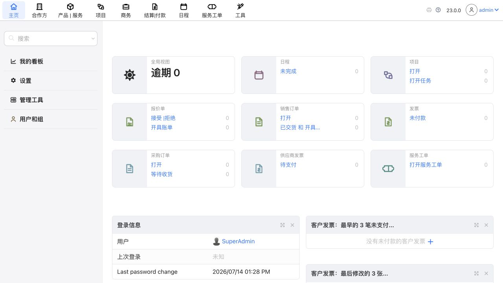 |
| 02 | 主题与显示设置 | 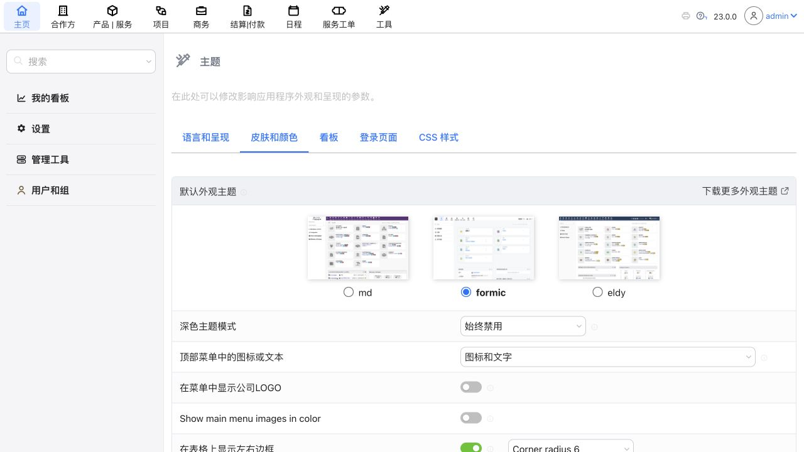 |
| 03 | 合作方列表 | 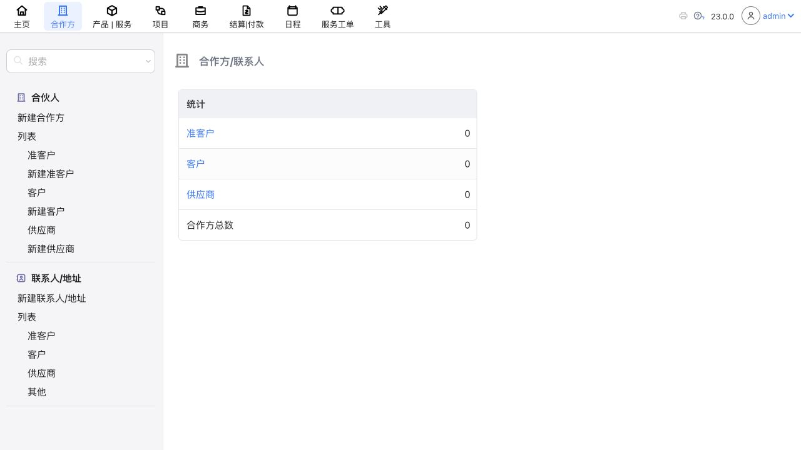 |
| 04 | 产品与服务列表 | 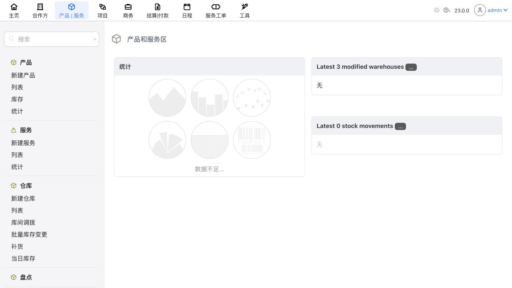 |
| 05 | 项目列表 | 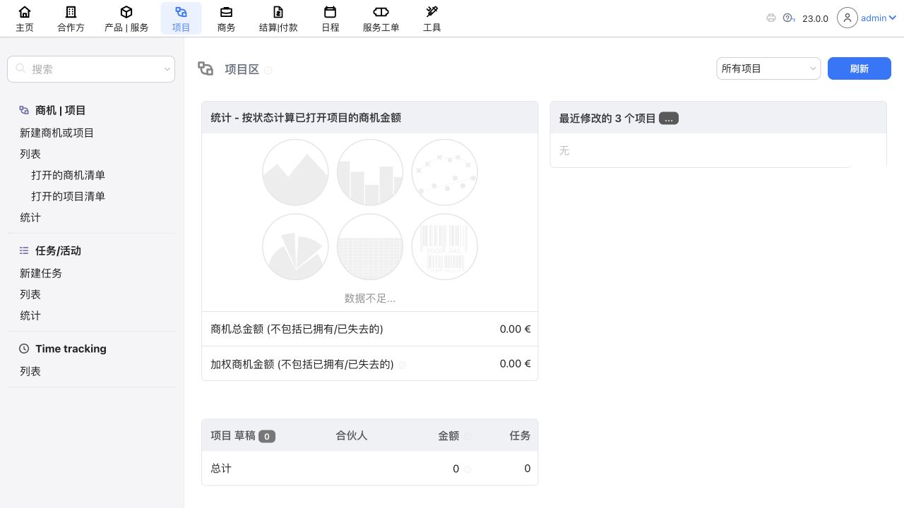 |
| 06 | 商务看板 | 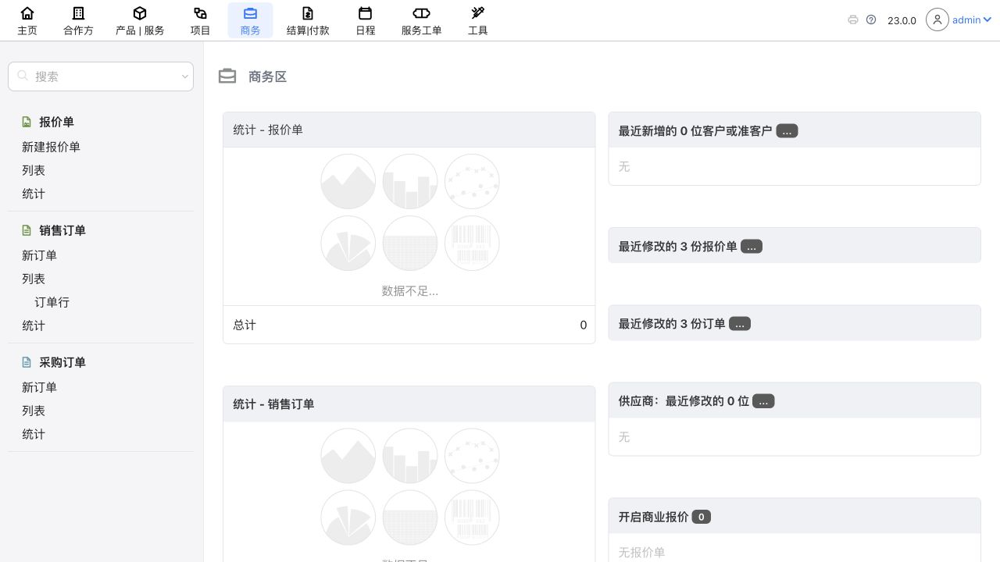 |
| 07 | 结算与付款 | 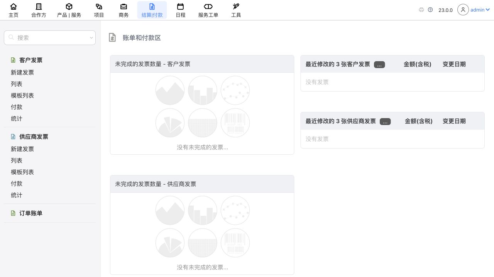 |
| 08 | 日程管理 | 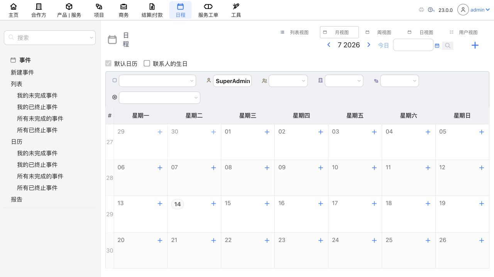 |
| 09 | 服务工单 | 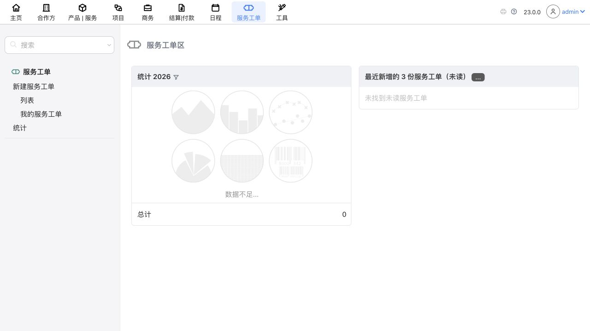 |
| 10 | CSS 编辑器 | 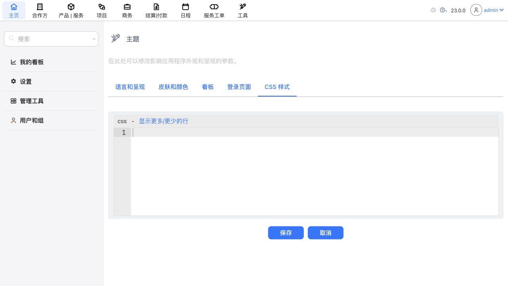 |
| 11 | 公司设置 | 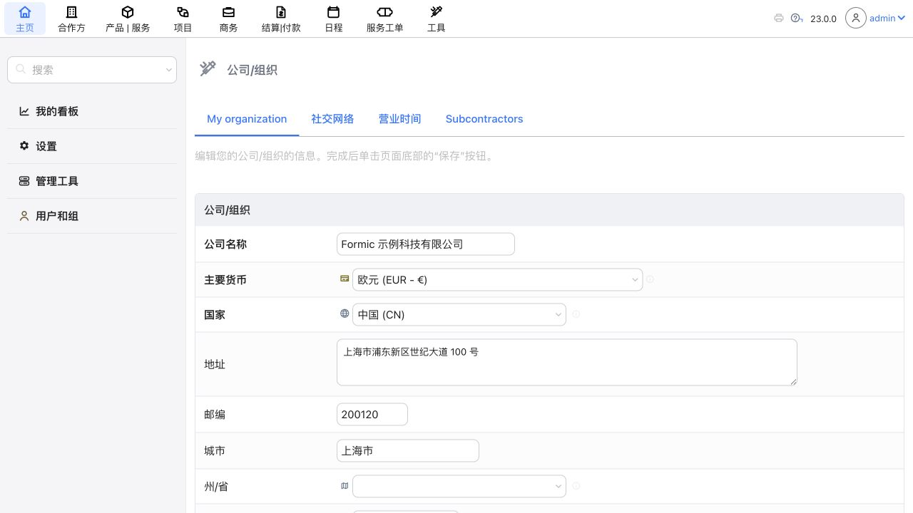 |
| 12 | 模块与应用设置 | 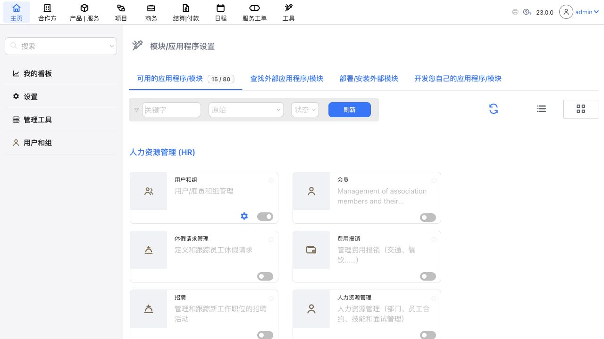 |
| 13 | 移动端宽度下的中文看板 | 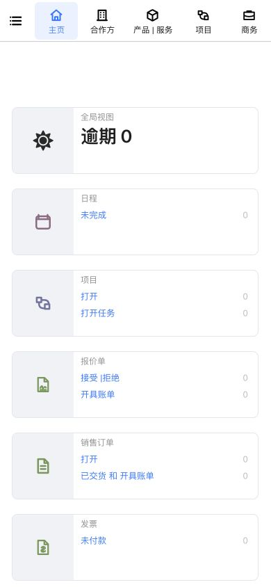 |
